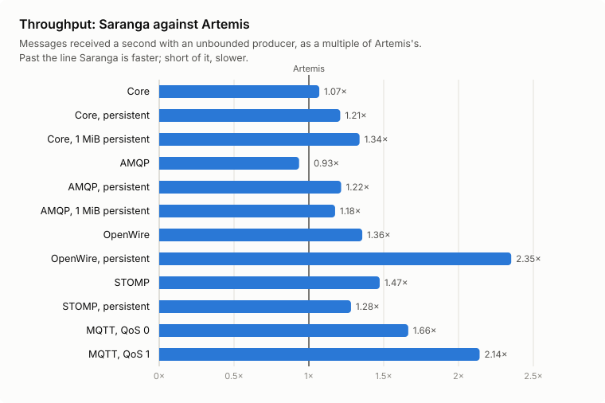
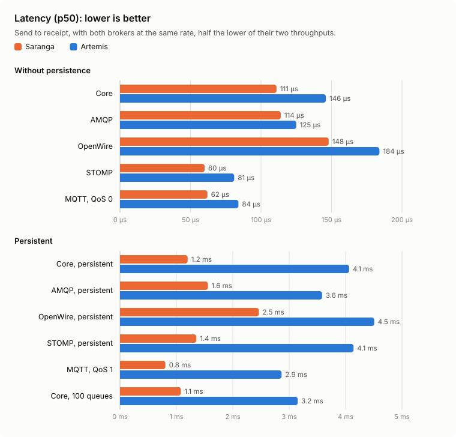
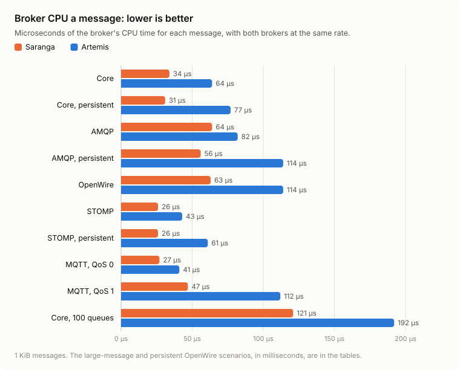
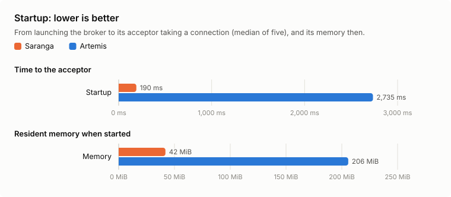
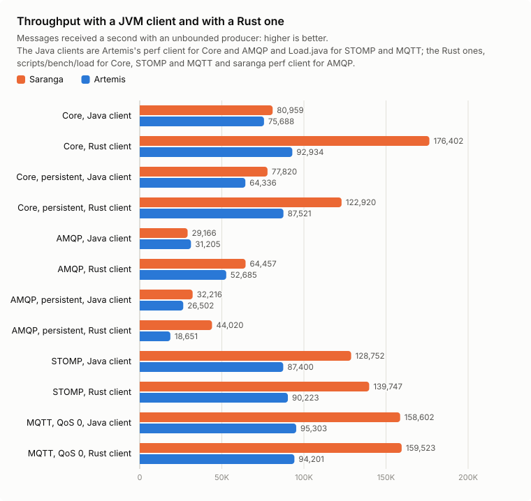

  

# Saranga

Saranga is a message broker written in Rust, inspired by [Apache ActiveMQ Artemis](https://activemq.apache.org/components/artemis/) 2.57.0, and built to work interchangeably with it. It speaks the same wire protocols as Artemis: Core, AMQP 1.0, OpenWire, STOMP, MQTT 3.1.1 and 5, and WebSockets. It reads and writes the same journal, bindings, paging and large-message files, and takes the same `broker.xml`.

It is in Phase 11 (hardening and 1.0) of the plan in [PHASES.md](https://github.com/grepjava/saranga/blob/main/PHASES.md). [COMPAT.md](COMPAT.md) has the pinned version and the deliberate differences. The [user guide](docs/guide/README.md) covers installing, configuring and running it, and migrating from Artemis.

## Why Saranga?

Saranga is a high-performance, memory-safe message broker built in Rust, designed to work as Apache ActiveMQ Artemis works, with the efficiency, reliability and operational simplicity of a native application.

- **Seamless Artemis Compatibility.** Saranga targets full compatibility with Apache ActiveMQ Artemis 2.57.0, preserving wire protocols, `broker.xml` configuration, journal, paging and large-message formats, management interfaces and command-line tooling. Existing Artemis clients, tools, configurations and data files are intended to work unchanged; [COMPAT.md](COMPAT.md) lists where Saranga still differs. Saranga's compatibility roadmap tracks upstream Artemis releases to maintain interoperability as the platform evolves.
- **High Availability and Clustering Across Both Brokers.** Saranga is designed to operate interchangeably with Artemis in high-availability configurations, serving as either primary or backup through shared storage, replication or pluggable quorum mechanisms. Mixed Artemis–Saranga clusters support message load balancing, redistribution, grouping, federation, bridges, broker connections and bidirectional mirroring. This enables incremental, node-by-node migration without planned downtime, while preserving failover and failback capabilities.
- **Native Performance, Without JVM Overhead.** Compiled into a standalone native executable, Saranga eliminates JVM startup, warm-up and tuning requirements. Benchmarks show startup in under 200 ms versus 2.7 seconds for Artemis, about 14 times faster, lower latency in every tested scenario, and higher throughput in all but one.
- **Memory Safety Without Garbage Collection.** Built in Rust, Saranga uses compile-time ownership, borrowing and type-safety guarantees to prevent common memory-safety defects and data races in safe code. With no garbage collector, it also avoids garbage-collection pauses. The limited use of `unsafe` is isolated to operating-system integrations, including file locking, disk-space queries, local-time handling and terminal operations.
- **Greater Resource Efficiency.** Saranga uses less broker CPU per message in all 13 benchmark scenarios, with CPU reductions of 43–60% for persistent and large-message workloads. Its initial memory footprint is approximately 42 MiB compared with Artemis's 206 MiB, while OpenWire, STOMP and MQTT workloads consume only 5–20% of Artemis's memory in the measured scenarios. This translates into greater workload density and more efficient infrastructure utilization.
- **Engineered for Edge Deployments.** With a compact memory footprint, rapid startup and no JVM dependency, Saranga extends enterprise-grade messaging to edge gateways, resource-constrained devices and distributed environments where conventional JVM-based brokers may be impractical.
- **Lower Cloud Infrastructure Costs.** Reduced CPU and memory consumption enables smaller compute instances, higher broker density per host and more efficient container deployments. For equivalent messaging workloads, these improvements create opportunities to reduce infrastructure spending without sacrificing protocol compatibility or throughput.

Saranga combines the established messaging capabilities of Apache ActiveMQ Artemis with Rust's memory safety, native execution and resource efficiency—providing a practical path to modernize messaging infrastructure without abandoning existing Artemis investments.

## Building

    cargo build --release -p saranga-cli

The binary is `target/release/saranga`. `saranga create <dir>` makes an instance as `artemis create` does, and `<dir>/bin/artemis run` starts it.

## The Saranga console

Saranga has a web console of its own at `http://localhost:8161/saranga/`, built into the binary, so it needs no `console.war`, no JVM and no Node.js at run time. It takes the same users, console roles and permissions as Artemis's console, and every call goes through the same guard and audit as Jolokia.

- **What Artemis's console does.** The overview, the connections, sessions, consumers, producers, addresses and queues, with closes, creates and deletes. Browsing a queue's messages and moving, copying, retrying, resending or deleting them. Sending a message. The explorer of every management resource, the diagram and the preferences.
- **Live data.** The pages follow the broker over one server-sent-events stream instead of polling, the charts open on the last hour of the broker's own history, and the events page shows the management notifications as they come.
- **A typed API** at `/saranga/api/v1`, described as OpenAPI 3.1 at `/saranga/api/v1/openapi.json`.

- **The cluster and the broker's administration.** Every node of the cluster, Artemis or Saranga, with high availability and bridges; address settings, diverts, acceptors, users and security settings, XA transactions and a dead-letter workbench.
- **Accessible, and at a phone's width.** Every page is checked against WCAG 2.1 AA.

It is in Saranga 1.1.0 and later; [docs/console-design.md](docs/console-design.md) records how it was built. To include it in a build from source, run `npm ci && npm run build` in `console/` (Node.js is needed only for this step) before `cargo build`; without that, `/saranga/` serves a page that says how. [Management](docs/guide/management.md#the-saranga-console) in the guide describes it in full. Artemis's own console can still be served alongside it.

## Performance against Artemis

Both brokers ran on the same machine, with the same clients, in instances made by their own `create`, each on an empty NIO journal with `journal-datasync` on. Messages are 1 KiB except in the large-message rows, which are 1 MiB.

<picture>
  <source media="(prefers-color-scheme: dark)" srcset="docs/images/bench/throughput-dark.svg">
  
</picture>

<picture>
  <source media="(prefers-color-scheme: dark)" srcset="docs/images/bench/latency-dark.svg">
  
</picture>

<picture>
  <source media="(prefers-color-scheme: dark)" srcset="docs/images/bench/cpu-dark.svg">
  
</picture>

<picture>
  <source media="(prefers-color-scheme: dark)" srcset="docs/images/bench/startup-dark.svg">
  
</picture>

### Without a JVM in the client

Artemis's perf client and Load.java run on a JVM, on the client's four CPUs. To find out whether they, rather than the broker, were the limit, the Core, STOMP and MQTT scenarios were run again with a client written in Rust, [scripts/bench/load](scripts/bench/load), which keeps at most 1,000 messages sent and not yet received:

<picture>
  <source media="(prefers-color-scheme: dark)" srcset="docs/images/bench/clients-dark.svg">
  
</picture>

On Core, Saranga delivered 176,402 messages a second, more than twice what the JMS client received from it: the JMS client, not the broker, set Saranga's Core figure. Artemis went from 75,688 to 92,934. On STOMP and MQTT the two clients gave about the same figures, so the Java client was not the limit there.

### Where Saranga falls short

**Throughput on non-persistent AMQP**, 0.93 of Artemis's (29,166 messages a second against 31,205). Saranga took the producer's sends faster than Artemis did, 51,398 a second against 31,221, but delivered fewer of them, and the rest waited in the broker. The event loop running the producer's connection was saturated: decoding, routing and, once the backlog passed `global-max-size`, paging.

**Peak memory in two of the Java-client runs**: 857 against 618 MiB on non-persistent Core, and 1,186 against 585 MiB on persistent AMQP. It is not that Saranga needs more memory for a message (about 2 KB in both brokers). It is a backlog:

- The benchmark's producer sends as fast as the broker takes its messages, and its consumer receives as fast as it can. Both share the client's four CPUs.
- Saranga took sends faster than the JMS consumer could receive them. The messages it had taken and not yet delivered waited in memory, and the queue grew through the run.
- Artemis took sends no faster than they were received, so nothing accumulated.

| Scenario         | Broker  | Sent/s | Received/s | Backlog grows by |
| ---------------- | ------- | ------ | ---------- | ---------------- |
| Core             | Artemis | 75,684 | 75,688     | 0/s              |
| Core             | Saranga | 87,151 | 80,959     | 6,192/s          |
| AMQP, persistent | Artemis | 26,501 | 26,502     | 0/s              |
| AMQP, persistent | Saranga | 38,154 | 32,216     | 5,938/s          |

With a client that keeps up, there is no backlog: with the Rust client, Saranga's peak on Core was 65 MiB, against Artemis's 611 MiB. In production, a queue whose consumers fall behind grows in either broker until `global-max-size`, after which both page to disk.

### The machine and the full figures

|                                |                                                   |
| ------------------------------ | ------------------------------------------------- |
| CPU                            | Intel Core i5-8250U, 4 cores, 8 threads           |
| CPUs for the broker            | 0, 1, 4 and 5 (two cores and their hyperthreads)  |
| CPUs for the client            | 2, 3, 6 and 7                                     |
| Memory                         | 3.3 GiB                                           |
| Storage                        | SATA SSD, ext4                                    |
| Operating system               | Linux, kernel 7.3, dedicated to the run           |
| Java (Artemis and the clients) | OpenJDK 25.0.4.1, Artemis with a 2 GiB heap       |
| Versions                       | Artemis 2.57.0, Saranga at `bfd6752` (2026-11-02) |

Every figure, as tables

|                     | Artemis  | Saranga |
| ------------------- | -------- | ------- |
| Startup             | 2,735 ms | 190 ms  |
| Memory when started | 206 MiB  | 42 MiB  |

**Throughput (messages a second) and peak memory** with an unbounded producer, over 60 s after a 15 s warmup, with the Java clients (Artemis's own perf client for Core and AMQP):

| Scenario               | Artemis msg/s | Saranga msg/s | Saranga/Artemis | Artemis peak RSS | Saranga peak RSS |
| ---------------------- | ------------- | ------------- | --------------- | ---------------- | ---------------- |
| Core                   | 75,688        | 80,959        | 1.07            | 618 MiB          | 857 MiB          |
| Core, persistent       | 64,336        | 77,820        | 1.21            | 644 MiB          | 263 MiB          |
| Core, 1 MiB persistent | 62            | 83            | 1.34            | 570 MiB          | 72 MiB           |
| AMQP                   | 31,205        | 29,166        | 0.93            | 2,213 MiB        | 1,727 MiB        |
| AMQP, persistent       | 26,502        | 32,216        | 1.22            | 585 MiB          | 1,186 MiB        |
| AMQP, 1 MiB persistent | 97            | 114           | 1.18            | 804 MiB          | 154 MiB          |
| OpenWire               | 50,556        | 68,598        | 1.36            | 684 MiB          | 65 MiB           |
| OpenWire, persistent   | 284           | 668           | 2.35            | 609 MiB          | 54 MiB           |
| STOMP                  | 87,400        | 128,752       | 1.47            | 619 MiB          | 58 MiB           |
| STOMP, persistent      | 71,878        | 92,120        | 1.28            | 621 MiB          | 117 MiB          |
| MQTT, QoS 0            | 95,303        | 158,602       | 1.66            | 608 MiB          | 60 MiB           |
| MQTT, QoS 1            | 44,872        | 96,067        | 2.14            | 2,294 MiB        | 111 MiB          |

**Broker CPU a message and latency (p50 / p99, send to receipt)** with both brokers at the same rate, half the lower of their two throughputs:

| Scenario                     | Rate, msg/s | Artemis CPU a message | Saranga CPU a message | Artemis p50 / p99 | Saranga p50 / p99 |
| ---------------------------- | ----------- | --------------------- | --------------------- | ----------------- | ----------------- |
| Core                         | 37,844      | 64 µs                 | 34 µs                 | 146 µs / 739 µs   | 111 µs / 233 µs   |
| Core, persistent             | 32,168      | 77 µs                 | 31 µs                 | 4.1 ms / 12.0 ms  | 1.2 ms / 9.7 ms   |
| Core, 1 MiB persistent       | 31          | 19.6 ms               | 9.9 ms                | 22.9 ms / 39.4 ms | 17.8 ms / 31.6 ms |
| Core, 100 queues, persistent | 10,000      | 192 µs                | 121 µs                | 3.2 ms / 6.1 ms   | 1.1 ms / 3.2 ms   |
| AMQP                         | 14,583      | 82 µs                 | 64 µs                 | 125 µs / 311 µs   | 114 µs / 196 µs   |
| AMQP, persistent             | 13,251      | 114 µs                | 56 µs                 | 3.6 ms / 35.3 ms  | 1.6 ms / 28.9 ms  |
| AMQP, 1 MiB persistent       | 48          | 16.3 ms               | 9.2 ms                | 22.9 ms / 37.9 ms | 20.2 ms / 34.3 ms |
| OpenWire                     | 25,278      | 114 µs                | 63 µs                 | 184 µs / 1.6 ms   | 148 µs / 688 µs   |
| OpenWire, persistent         | 142         | 3.6 ms                | 1.7 ms                | 4.5 ms / 6.6 ms   | 2.5 ms / 2.8 ms   |
| STOMP                        | 43,700      | 43 µs                 | 26 µs                 | 81 µs / 562 µs    | 60 µs / 147 µs    |
| STOMP, persistent            | 35,939      | 61 µs                 | 26 µs                 | 4.1 ms / 12.2 ms  | 1.4 ms / 11.1 ms  |
| MQTT, QoS 0                  | 47,651      | 41 µs                 | 27 µs                 | 84 µs / 501 µs    | 62 µs / 139 µs    |
| MQTT, QoS 1                  | 22,436      | 112 µs                | 47 µs                 | 2.9 ms / 13.6 ms  | 805 µs / 7.9 ms   |

**With the Rust client**, throughput and, at the same rate, latency and CPU a message:

| Scenario          | Artemis msg/s | Saranga msg/s | Saranga/Artemis | Artemis p50 / p99 | Saranga p50 / p99 | Artemis CPU a message | Saranga CPU a message |
| ----------------- | ------------- | ------------- | --------------- | ----------------- | ----------------- | --------------------- | --------------------- |
| Core              | 92,934        | 176,402       | 1.90            | 121 µs / 389 µs   | 73 µs / 116 µs    | 59 µs                 | 22 µs                 |
| Core, persistent  | 87,521        | 122,920       | 1.40            | 1.6 ms / 12.0 ms  | 1.2 ms / 10.8 ms  | 67 µs                 | 18 µs                 |
| STOMP             | 90,223        | 139,747       | 1.55            | 75 µs / 173 µs    | 56 µs / 113 µs    | 42 µs                 | 25 µs                 |
| STOMP, persistent | 72,179        | 96,565        | 1.34            | 4.1 ms / 12.6 ms  | 1.3 ms / 11.2 ms  | 59 µs                 | 25 µs                 |
| MQTT, QoS 0       | 94,201        | 159,523       | 1.69            | 83 µs / 293 µs    | 63 µs / 126 µs    | 40 µs                 | 26 µs                 |
| MQTT, QoS 1       | 44,652        | 96,857        | 2.17            | 2.9 ms / 41.9 ms  | 793 µs / 7.2 ms   | 110 µs                | 45 µs                 |

Runs on this machine vary by up to 5%. The method, the machine and how to run [scripts/bench.sh](https://github.com/grepjava/saranga/blob/main/scripts/bench.sh) yourself are in [docs/benchmarks.md](docs/benchmarks.md).

## Licence

Apache License 2.0; see [LICENSE](LICENSE).
