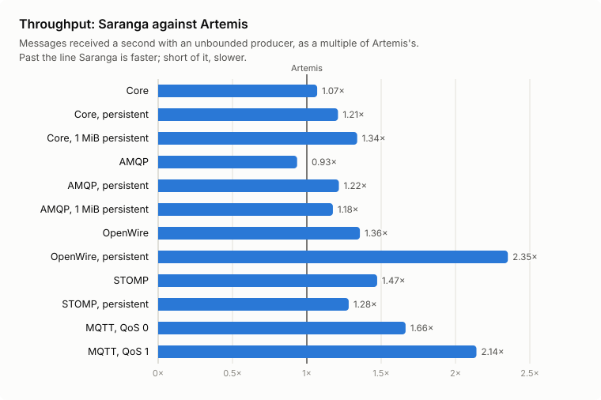
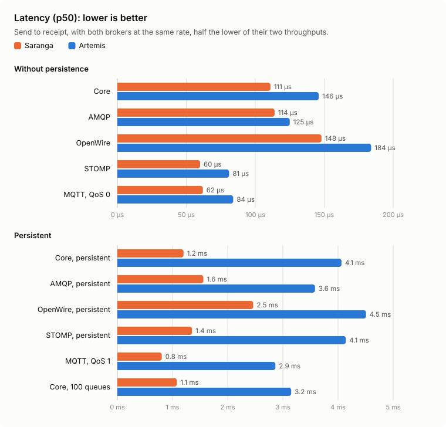
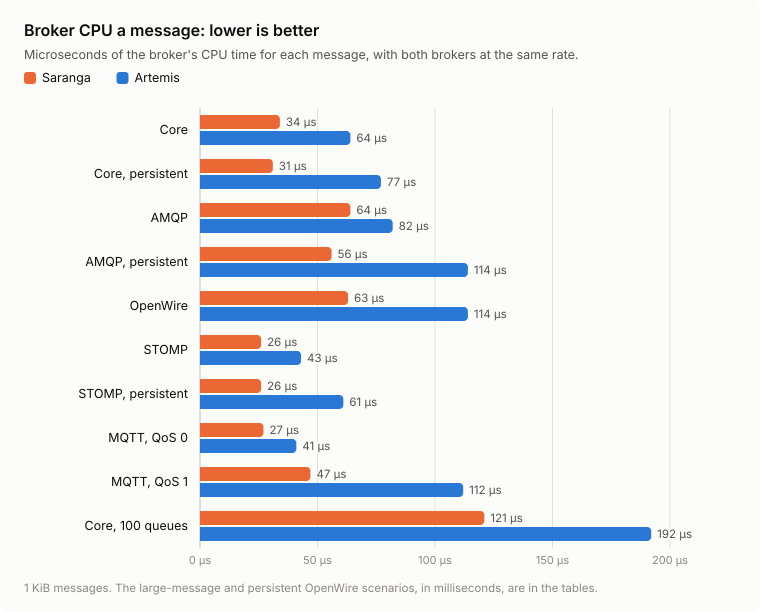
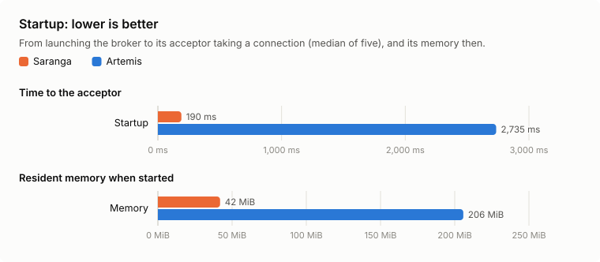
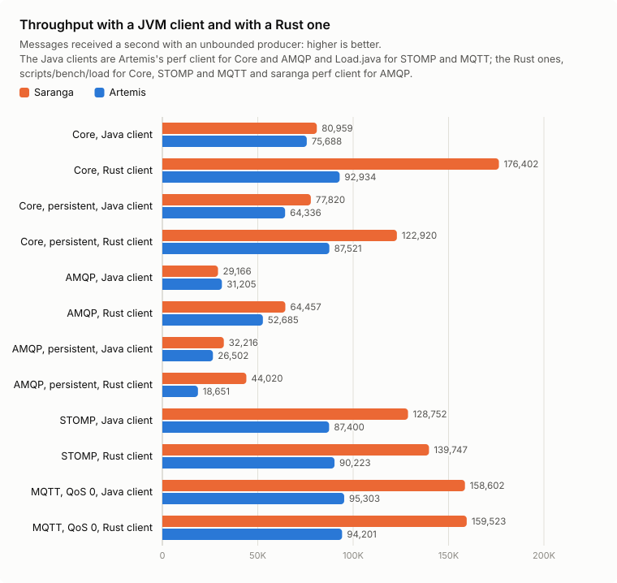

# Benchmarks

Saranga against Apache Artemis 2.57.0, on the same machine and in the same scenarios, made by [scripts/bench.sh](https://github.com/grepjava/saranga/blob/main/scripts/bench.sh).

## Method

- **The same client for both.**
  - For Core and AMQP it is Artemis's own `artemis perf client`: the Core JMS client, or Qpid JMS for AMQP. A producer and a consumer on `queue://BENCH`, with up to 100 sends outstanding (`--max-pending 100`).
  - Artemis's perf client speaks no other protocol, so for OpenWire, STOMP and MQTT both brokers get [scripts/bench/Load.java](https://github.com/grepjava/saranga/blob/main/scripts/bench/Load.java). It runs a producer and a consumer on one queue with 1 KiB messages, with at most 1,000 sent and not yet received.
    - OpenWire goes through the ActiveMQ 5 JMS client in Artemis's `lib`.
    - STOMP 1.2 and MQTT 3.1.1 go over a plain socket. The STOMP producer asks for a receipt every 100 sends, with up to 10 outstanding. The MQTT producer has up to 100 QoS 1 sends unacknowledged.
  - **A second run without a JVM in the client.** [scripts/bench/load](https://github.com/grepjava/saranga/tree/main/scripts/bench/load) does Load.java's work in Rust, for Core (through saranga-client, Saranga's Core client, which speaks to Artemis as to Saranga), STOMP and MQTT. Its Core producer sends BYTES messages, as the perf client does, and its consumer acknowledges each one, with at most 1,000 sent and not yet received. It does not speak AMQP or OpenWire. For AMQP the second run uses `saranga perf client`, Saranga's port of Artemis's perf client, with the same options as the first. OpenWire has no Rust client here.
- **Instances made by each broker's own `create`**, with `--nio --no-autotune --no-web` and otherwise their defaults. Both use the NIO journal, which is the one Saranga writes, with `journal-datasync` on. Artemis has its default heap (`-Xms512M -Xmx2G`).
- **Separate cores.** The broker runs on half the CPUs and the client on the other half (`taskset`). Both brokers run from a copy on the same local file system, and every run starts on an empty data directory.
- **Throughput:** messages received a second with the producer unbounded. It is the mean of the per-second samples from the end of a 15 s warmup to the producer's last send, over 60 s of sending. The backlog a broker drains after the producer stops is not counted.
- **Latency:** both brokers run again at the same rate, half the lower of their two throughputs. The figure is the client's transfer time, from send to receipt, at p50 and p99.
- **CPU a message:** the broker's CPU time from three seconds after the warmup to the end of the run, divided by the messages received in that time. The table gives it from the latency run, where both brokers carry the same load.
- **Memory:** the broker's peak resident set (`VmHWM`) at the end of the throughput run.
- **Startup:** the time from launching `artemis run` until the acceptor takes a connection, the median of five starts. The resident memory is read once the broker is up.
- **Scenarios:**
  - `core`, `core-persistent`, `amqp` and `amqp-persistent` send 1 KiB messages.
  - `core-large` and `amqp-large` send persistent 1 MiB messages, which both brokers handle as large messages.
  - `many-queues` runs 100 persistent Core queues, each with its own producer and consumer, at 10,000 messages a second in all. Unbounded, 100 producers outrun their consumers and the run measures a backlog: Artemis stalled that way after a minute.
  - `openwire`, `stomp` and `mqtt` send non-persistent 1 KiB messages; for MQTT that means QoS 0.
  - `openwire-persistent`, `stomp-persistent` and `mqtt-persistent` send them persistent; for MQTT that means QoS 1. The OpenWire client sends a persistent message synchronously, so that scenario's rate is one journal sync's round trip.

## Results

Run on 2026-11-02 at Saranga commit `bfd6752`, every scenario in one run with each client, with no failures.

The machine was a dedicated Linux box (Ubuntu 26.10, kernel 7.3) with an i5-8250U: four cores, eight threads. The broker had CPUs 0, 1, 4 and 5 (two cores and their hyperthreads), and the client the rest. It had 3.3 GiB of memory and ext4 on a SATA SSD. Artemis and the Java clients ran on OpenJDK 25.0.4.1.

### With the Java clients

<picture>
  <source media="(prefers-color-scheme: dark)" srcset="images/bench/throughput-dark.svg">
  
</picture>

<picture>
  <source media="(prefers-color-scheme: dark)" srcset="images/bench/latency-dark.svg">
  
</picture>

<picture>
  <source media="(prefers-color-scheme: dark)" srcset="images/bench/cpu-dark.svg">
  
</picture>

<picture>
  <source media="(prefers-color-scheme: dark)" srcset="images/bench/startup-dark.svg">
  
</picture>

| Startup | Artemis | Saranga |
|---|---|---|
| Time to the acceptor (median of 5) | 2,735 ms | 190 ms |
| Resident memory when started | 206 MiB | 42 MiB |

| Scenario | Artemis msg/s | Saranga msg/s | Saranga/Artemis | Latency at msg/s | Artemis p50 / p99 | Saranga p50 / p99 | Artemis CPU a message | Saranga CPU a message | Artemis peak RSS | Saranga peak RSS |
|---|---|---|---|---|---|---|---|---|---|---|
| core | 75,688 | 80,959 | 1.07 | 37,844 | 146 us / 739 us | 111 us / 233 us | 64 us | 34 us | 618 MiB | 857 MiB |
| core-persistent | 64,336 | 77,820 | 1.21 | 32,168 | 4.1 ms / 12.0 ms | 1.2 ms / 9.7 ms | 77 us | 31 us | 644 MiB | 263 MiB |
| amqp | 31,205 | 29,166 | 0.93 | 14,583 | 125 us / 311 us | 114 us / 196 us | 82 us | 64 us | 2,213 MiB | 1,727 MiB |
| amqp-persistent | 26,502 | 32,216 | 1.22 | 13,251 | 3.6 ms / 35.3 ms | 1.6 ms / 28.9 ms | 114 us | 56 us | 585 MiB | 1,186 MiB |
| core-large | 62 | 83 | 1.34 | 31 | 22.9 ms / 39.4 ms | 17.8 ms / 31.6 ms | 19.6 ms | 9.9 ms | 570 MiB | 72 MiB |
| amqp-large | 97 | 114 | 1.18 | 48 | 22.9 ms / 37.9 ms | 20.2 ms / 34.3 ms | 16.3 ms | 9.2 ms | 804 MiB | 154 MiB |
| many-queues | 9,999 | 9,999 | 1.00 | 10,000 | 3.2 ms / 6.1 ms | 1.1 ms / 3.2 ms | 192 us | 121 us | 619 MiB | 147 MiB |
| openwire | 50,556 | 68,598 | 1.36 | 25,278 | 184 us / 1.6 ms | 148 us / 688 us | 114 us | 63 us | 684 MiB | 65 MiB |
| openwire-persistent | 284 | 668 | 2.35 | 142 | 4.5 ms / 6.6 ms | 2.5 ms / 2.8 ms | 3.6 ms | 1.7 ms | 609 MiB | 54 MiB |
| stomp | 87,400 | 128,752 | 1.47 | 43,700 | 81 us / 562 us | 60 us / 147 us | 43 us | 26 us | 619 MiB | 58 MiB |
| stomp-persistent | 71,878 | 92,120 | 1.28 | 35,939 | 4.1 ms / 12.2 ms | 1.4 ms / 11.1 ms | 61 us | 26 us | 621 MiB | 117 MiB |
| mqtt | 95,303 | 158,602 | 1.66 | 47,651 | 84 us / 501 us | 62 us / 139 us | 41 us | 27 us | 608 MiB | 60 MiB |
| mqtt-persistent | 44,872 | 96,067 | 2.14 | 22,436 | 2.9 ms / 13.6 ms | 805 us / 7.9 ms | 112 us | 47 us | 2,294 MiB | 111 MiB |

In `mqtt-persistent`'s latency run, neither broker quite kept the rate: Artemis received 21,938 msg/s and Saranga 22,153.

### With the Rust client

The scenarios a Rust client speaks (`CLIENT=rust`): [scripts/bench/load](https://github.com/grepjava/saranga/tree/main/scripts/bench/load) for Core, STOMP and MQTT, and `saranga perf client` for AMQP. The AMQP rows are from a run of those two scenarios later the same day.

<picture>
  <source media="(prefers-color-scheme: dark)" srcset="images/bench/clients-dark.svg">
  
</picture>

| Startup | Artemis | Saranga |
|---|---|---|
| Time to the acceptor (median of 5) | 2,666 ms | 169 ms |
| Resident memory when started | 222 MiB | 44 MiB |

| Scenario | Artemis msg/s | Saranga msg/s | Saranga/Artemis | Latency at msg/s | Artemis p50 / p99 | Saranga p50 / p99 | Artemis CPU a message | Saranga CPU a message | Artemis peak RSS | Saranga peak RSS |
|---|---|---|---|---|---|---|---|---|---|---|
| core | 92,934 | 176,402 | 1.90 | 46,467 | 121 us / 389 us | 73 us / 116 us | 59 us | 22 us | 611 MiB | 65 MiB |
| core-persistent | 87,521 | 122,920 | 1.40 | 43,760 | 1.6 ms / 12.0 ms | 1.2 ms / 10.8 ms | 67 us | 18 us | 597 MiB | 100 MiB |
| amqp | 52,685 | 64,457 | 1.22 | 26,342 | 123 us / 369 us | 115 us / 245 us | 77 us | 53 us | 571 MiB | 65 MiB |
| amqp-persistent | 18,651 | 44,020 | 2.36 | 9,325 | 2.8 ms / 4.5 ms | 1.2 ms / 2.5 ms | 93 us | 52 us | 582 MiB | 87 MiB |
| stomp | 90,223 | 139,747 | 1.55 | 45,111 | 75 us / 173 us | 56 us / 113 us | 42 us | 25 us | 647 MiB | 55 MiB |
| stomp-persistent | 72,179 | 96,565 | 1.34 | 36,089 | 4.1 ms / 12.6 ms | 1.3 ms / 11.2 ms | 59 us | 25 us | 668 MiB | 105 MiB |
| mqtt | 94,201 | 159,523 | 1.69 | 47,100 | 83 us / 293 us | 63 us / 126 us | 40 us | 26 us | 593 MiB | 63 MiB |
| mqtt-persistent | 44,652 | 96,857 | 2.17 | 22,326 | 2.9 ms / 41.9 ms | 793 us / 7.2 ms | 110 us | 45 us | 2,333 MiB | 114 MiB |

In `mqtt-persistent`'s latency run, Artemis received 21,816 msg/s and Saranga 22,025.

## Reading them

- **Throughput.**
  - With the Java clients it is higher for Saranga in 11 of the 12 unbounded scenarios: 7% on Core, 18 to 34% with persistent Core and AMQP and with large messages, 28 to 66% on OpenWire, STOMP and MQTT, and 2.1 and 2.35 times on persistent MQTT and OpenWire. Both keep up with 100 queues at 10,000 messages a second.
  - On non-persistent AMQP it is 7% lower, and the client, not the broker, was the limit: the Qpid JMS client used 387% of its four CPUs and its consumer received about 30,000 a second from either broker. Saranga took sends at 51,398 a second, against Artemis's 31,221, and the rest waited in it. In a shorter run the same day Saranga came out ahead (30,889 against 30,051), and at a fixed 30,000 a second Saranga kept up while Artemis fell behind.
  - With the Rust clients it is 1.22 to 2.36 times Artemis's. On AMQP it is 64,457 a second against 52,685, and 44,020 persistent against 18,651; Artemis's persistent AMQP figure was higher with Qpid JMS (26,502), and against that Saranga's is 1.66 times. On Core it is 176,402 a second, where the Java client got 80,959: on Core the JMS client, not the broker, set Saranga's figure. Artemis gains less from the change (75,688 to 92,934). On STOMP and MQTT both clients give about the same figures for both brokers, so Load.java was not the limit there.
- **Startup** is about 14 times faster, at a fifth of the memory. It varies from start to start: the medians in the two runs were 190 and 169 ms, and 143 ms in the previous run.
- **CPU a message at the same rate.**
  - It is lower for Saranga in every scenario, with either client: by 43 to 60% with persistent and large messages, 37% with 100 queues, 34 to 47% on non-persistent Core, OpenWire, STOMP and MQTT, and 22% on non-persistent AMQP. With the Rust client, 63% lower on non-persistent Core and 73% on persistent Core.
- **Latency at the same rate.**
  - Without persistence, p50 is 9 to 26% lower with the Java clients and 7 to 40% lower with the Rust clients.
  - With persistent 1 KiB messages, p50 is 28 to 44% of Artemis's, and a little over half on persistent OpenWire. Persistent Core with the Rust client is the exception: Artemis's p50 was 1.6 ms there, and Saranga's 1.2 ms.
  - With large messages it is 12 and 22% lower, and with 100 queues a third of Artemis's (Artemis's was 1.1 ms in the previous run, so that one moves a lot).
  - p99 is lower in every scenario, with either client. `amqp-persistent`'s p99 moves a lot from run to run: in an earlier run, Artemis's was 36.6 ms and Saranga's 6.9 ms.
- **Peak memory** is a twentieth to a fifth of Artemis's on OpenWire, STOMP and MQTT, an eighth to a quarter with large messages and many queues, and two fifths with persistent Core. With the Rust clients, under which no backlog formed, it is 65 and 100 MiB on Core and 65 and 87 MiB on AMQP. With the Java clients, where the producer outran the consumer during the run, a backlog of messages was held in memory, and the peaks are high:
  - Saranga's non-persistent Core and AMQP;
  - Saranga's persistent AMQP.

  Artemis's peak on non-persistent AMQP is high too, though it sent and delivered at the same rate.

  Both brokers page only beyond `global-max-size`, which is 1 GiB for each here (half of Artemis's 2 GiB heap, and Saranga's default).
- **The noise.** Runs on this machine move by up to 5% between runs on the same day. Its CPU also throttles once warm: both brokers lose about a tenth of their rate after the first 30 s, which the 15 s warmup only partly excludes.

## Running it

    CARGO_TARGET_DIR=~/saranga-target WORK=~/saranga-bench scripts/bench.sh [SCENARIO...]

The script runs on Linux. It needs the Artemis distribution that `scripts/build-artemis.sh` builds, and Java 17 or later. `WORK` should be on a local file system: in WSL, not under `/mnt`. `DURATION`, `WARMUP`, `STARTS`, `NUM_QUEUES`, `MANY_RATE`, `MAX_PENDING`, `LOAD_INFLIGHT`, `BROKER_CPUS` and `CLIENT_CPUS` change the runs. On a machine without Rust, `SARANGA_BIN` names a `saranga` binary built elsewhere, and `ARTEMIS_DIST` the Artemis distribution. The results are written to `$WORK/results.md` and `$WORK/results.tsv`, and each run's client output and report to `$WORK/runs`.

`CLIENT=rust` runs the eight scenarios with Rust clients instead: `saranga perf client` for AMQP, and scripts/bench/load for the rest, built with cargo unless `LOAD_BIN` names a `load` binary built elsewhere.

The charts are drawn from the results by [scripts/bench/charts.mjs](https://github.com/grepjava/saranga/blob/main/scripts/bench/charts.mjs), with Node.js: `node scripts/bench/charts.mjs JAVA_RESULTS.tsv [RUST_RESULTS.tsv] docs/images/bench` writes each as an SVG for a light page and another for a dark one.
